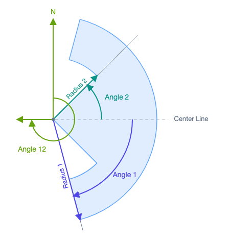
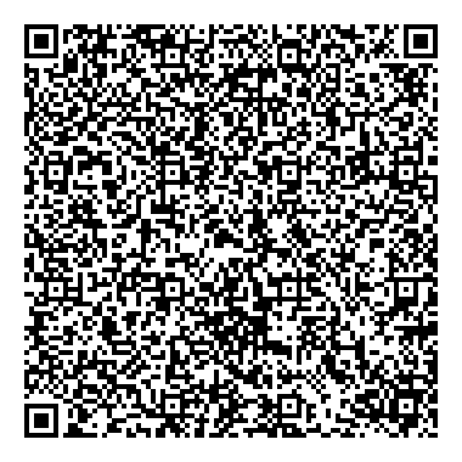
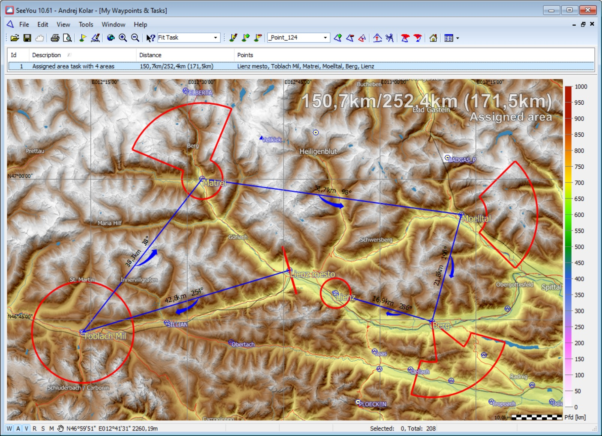

# SeeYou Task QR Code specification

*Copyright © 2026-11-23, Naviter d.o.o. All Rights Reserved. Version 2.3.0*

The Task QR Code format is used to share tasks between devices equipped with a QR Code scanner or a camera. This file format was originally developed by XCTrack for use in their software. This document follows the version 2 format of the [XCTrack specification](https://xctrack.org/Competition_Interfaces.html) and describes the Naviter extension used by SeeYou Navigator, Oudie N and Omni.

The Naviter extension allows all sports and all task types to be supported by this specification. Not least, Hike and Fly for paragliding and Assigned Area Tasks for gliding are part of the extension. It uses XCTrack's extension mechanism (`"x"`), so tools that follow the XCTrack specification keep it.

## Changes in 2.3.0

- The zipped QR code (`XCTSKZ:`), see [Plain and zipped QR codes](#plain-and-zipped-qr-codes). SeeYou Navigator writes the zipped code by default.
- The Naviter extension moved from `"o"` to XCTrack's extension lists `"x"`, with the id `"NAV"`. Readers should still read `"o"` from older codes.
- Naviter task options version `3`, with the XC flag `xc`.
- Turnpoint sector shape `s` and direction type `dt`.
- XCTrack's goal finish altitude `g.fa`, written besides the Naviter finish altitude.
- A QR code may hold XCTrack's long format 1.

## Plain and zipped QR codes

A QR code holds the task JSON in one of two forms:

- **Plain:** `XCTSK:` followed by the JSON.
- **Zipped:** `XCTSKZ:` followed by the JSON (UTF-8) compressed in the zlib format (RFC 1950) and encoded with standard base64 (RFC 4648, alphabet `+` `/`, with `=` padding; not base64url).

```
XCTSKZ:eNpt0ltvgjAUAOC/spxnQgqIGJ6sbmEmXpJp9uA0...
```

The zipped code is about a third shorter, so the QR code is smaller and easier to scan. XCTrack prefers it, and readers should accept both forms. A reader should also accept base64url and missing padding, as some writers produce them.

The JSON is usually the short format 2 described below. Readers should also accept XCTrack's long format 1 (`"version": 1`, the `.xctsk` file format) in either form.

## Conceptual Structure

The conceptual structure of the object is shown below with details given later in the document:

```
XCTSK:{
  "taskType": "CLASSIC",  Task Type             String            Required
  "version": 2,           XCTrack Version       Integer           Required
  "t": [                  Turnpoints            List of Objects   Required
    {                     Turnpoint Object      Object            Required
      "z":                Definition            String            Required
      "n":                Name                  String            Required
      "d":                Description           String            Optional
      "t":                Type                  Number            Optional
      "x": [              Extensions            List of Objects   Optional
        {                 Naviter Sector        Object            Optional
          "a1":           Angle 1               Float             Optional
          "a2":           Angle 2               Float             Optional
          "a12":          Direction             Float             Optional
          "r2":           Inner Radius          Integer           Optional
          "l":            Line Flag             Bool Integer      Optional
          "s":            Sector Shape          String            Optional
          "dt":           Direction Type        String            Optional
        }
      ]
    },
    ...
  ],
  "s": {                  Start Object          Object            Optional
    "g": [...]            Gates                 Array of Strings  Required
    "t":                  Type                  Integer           Required
    "d":                  Direction             Integer           Optional
  },
  "g": {                  Goal Object           Object            Optional
    "d":                  Task Deadline         String            Optional
    "t":                  Sector Shape          Integer           Optional
    "fa":                 Finish Altitude (AGL) Integer           Optional
  },
  "e":                    Geodetic System       Integer           Optional
  "x": [                  Extensions            List of Objects   Optional
    {                     Naviter Task Options  Object            Optional
      "id": "NAV"         Extension Id          String            Required
      "v": 3              SeeYou Version        Integer           Required
      "fa":               Finish Altitude (MSL) Integer           Optional
      "hf":               Hike & Fly Flag       Bool Integer      Optional
      "xc":               XC Flag               Bool Integer      Optional
      "tt":               Task Duration         Integer           Optional
      "bgi":              Before Gate Interval  Integer           Optional
      "gi":               Gate Interval         Integer           Optional
    }
  ]
}
```

**Encoding**: UTF-8

## Units

- **Coordinates:** Google's [Encoded Polyline Algorithm Format](https://developers.google.com/maps/documentation/utilities/polylinealgorithm) (string), example: `uxyzlO_}zj}DwnCg^`
- **Altitudes and Elevations:** Meters (integer), example: `1500`
- **Time:** UTC Time formatted as `"H:MM:SSZ"`, example: `"1:30:00Z"`
- **Duration and Intervals:** Duration in seconds (integer), example `3600` 
- **Angles:** Decimal Degrees (float), example: `45.73645`
- **Boolean Values** Are represented as an integer `1` (True) or `0`  false.

## Extensions `x`

XCTrack's specification lets each maker add data in extension lists:

- The task's `"x"` is a list of objects. Each has an `"id"` that names the maker and the version. Naviter's id is `"NAV"`.
- A turnpoint's `"x"` is a list in the same order as the task's list, without the `"id"`. The Naviter sector of a turnpoint is at the position of `"NAV"` in the task's list.

A writer that uses only the Naviter extension writes it as the first and only entry, for example `"x":[{"id":"NAV","v":3,"tt":10800}]` on the task and `"x":[{"a1":45,"a12":157.7}]` on a turnpoint. A turnpoint without Naviter data has no `"x"`. A reader finds `"NAV"` by its id, so other makers' entries may come before it.

Before version 2.3.0, the Naviter data was in `"o"` on the task and on each turnpoint (and `"na_o"` in version 1). Readers should still read it when the task has no `"NAV"` extension.

## Object and Property descriptions

### Task Type 

In the original specification only one type is available ("CLASSIC"). Naviter doesn't extend this field. Task type definitions are stored elsewhere as described below.

### Turnpoint Object

Each task turnpoint must be represented in the list of turnpoints with a turnpoint object. The turnpoint properties `"z", "n", "d", "t"` are specified by XCTrack, and the Naviter sector is a Naviter extension in `"x"`.

##### Turnpoint location `z`

Turnpoint specification is a string that encodes *4 different values*: turnpoint center coordinates longitude and latitude as well as the turnpoint altitude and cylinder radius. The four values are fed into the Google's [Encoded Polyline Algorithm Format](https://developers.google.com/maps/documentation/utilities/polylinealgorithm) to produce the encoded string.

Example:

```
lon   lat.  alt  r  
48.12 17.42 2300 500 -> "uxyzlO_}zj}DwnCg^"
```

##### Type `t`

Optional numerical property that defines if the turnpoint is a Start of Speed Section (SSS): `2` or an End of Speed Section (ESS): `3`. 

##### Naviter sector (in `x`)

*This is a Naviter extension.*

This extension allows you to define turnpoint sector shapes that are not circles. Such shapes are often used in gliding to describe Assigned Area turnpoints. With this extension it is possible to define an FAI sector, semicircle, a pie-slice, keyhole and many other shapes.

This schematic shows all the parameters available to define the shape of the turnpoint sector:


| Name  | Description                                                  | Data Type    |
| ----- | ------------------------------------------------------------ | ------------ |
| `a1`  | Angle 1 is half the width of the sector in degrees relative to the center line. 45 defines a right angle. | float     |
| `a2`  | Angle 2 is half of the inner width of the sector in degrees relative to the center line. 180 defines a full circle. | float     |
| `a12` | Bearing of the center line in degrees, clockwise from north, pointing towards the turnpoint. The zone lies at a12 + 180. | float        |
| `r2`  | Radius 2 in meters. Required if a2 is specified.             | integer      |
| `l`   | Line flag specifies if the sector is a line.                 | bool integer |
| `s`   | Sector shape, `"sector"` or `"custom"`, when the values above don't make it clear. A cylinder (`a1` 180) and a line (`l`) need none. | string |
| `dt`  | Direction type of a line or a custom sector: `"toNext"`, `"toPrevious"` or `"toStart"`. A fixed direction is given by `a12`; without either, the sector is symmetric. | string |

### Start Description `s`

This object adds start properties to a task.

##### Array of Times `g`

Defines the number and UTC times of gates for a task in chronological order. The first time also defines the start open time.

Example:

```
["12:30Z", "12:40Z", "12:50Z", "13:00Z"]
```

##### Start Type `t`

Defines the start type. The possible values are `1` (Race to Goal) or `2` (Elapsed Time).

##### Start Direction `d`

Defines the direction in which the start sector boundary must be crossed in order to count as a start. The possible values are either `1` (Entry) or `2` (Exit). XCTrack marks it obsolete and may leave it out; a reader must not require it.

### Goal Description `g`

Defines the goal properties.

##### Task Deadline `d`

Defines the task deadline (time until which the task must be completed). Example: `20:00:00Z`

##### Goal Sector Shape/Type `t`

Defines the shape of the last task turnpoint sector. Possible values are `1` (Line) or `2` (Cylinder). If this property is not defined, cylinder is assumed.

##### Finish Altitude `fa`

XCTrack's elevated goal: the altitude in meters above the last turnpoint's altitude (from its `z`). The Naviter finish altitude (MSL, below) is used before it when both are given.

A writer that has a Naviter finish altitude above the last turnpoint's altitude writes it here as well, as the difference, so XCTrack has it. Example: finish altitude `1350` MSL and the last turnpoint at `300` give `"fa": 1050`.

### Naviter task options (in `x`)

*This is a Naviter extension.*

##### Id `id`

Always `"NAV"`.

##### SeeYou Version `v`

The version of the Naviter task options, currently `3`. Before version `3`, every task with an elapsed time start was an XC task.

##### Finish Altitude `fa`

Defines the height of the finish line / sector in meters above mean sea level (MSL). Example: `1350`.

##### Task Time Duration  `tt`

Defines the length of the task. Usually used for Assigned Area Tasks in gliding. Formatted as a duration. Example `12600`.

##### Before Gate Interval `bgi`

Defines the wait time from pressing the pilot event marker (PEV) until gate open time for PEV start procedures. Formatted as a duration. Example `300`.

##### Gate Interval `gi`

Defines the time between gate open times of different start windows for tasks with multiple gate windows. Formatted as a duration. Example `900`.

##### Hike & Fly Flag `hf`

Specifies this task is a hike and fly task.

##### XC Flag `xc`

Specifies an XC task that has a start time. Without it, a paragliding or hang gliding task with an elapsed time start and a start time is a time trial.

### Geodetic System `e`

Defines the geodetic system of reference for the coordinates. Value `0` represents WGS84 and `1` represents FAI Sphere. If no system is specified, WGS 84 is assumed.

## Example QR Code

This is an example of a complex task with the extensions described in this document, as a zipped QR code:



The text in the above QR code:
```
XCTSKZ:eNpt0ltvgjAUAOC/spxnQgqIGJ6sbmEmXpJp9uA0BmfFjkodRR23/75ymxiX8HA4Ld859DSFyBX+Ij4RsGE4xvP5aAgKXEgoKA/A1hWIwP5IIZHrnp8xHHtp5hxZn19f5Ua5BcaUBMnTkYiIy8yuyUD5qQR+SoCBrSngarrMmYZq5utcqdirrIX5hWQOZ3hzeqvZBd8y9/PwNKGsZhezwRgPi7IV6WrS7KFaNU3VuqF+zn1MkiR3vtM+P6xWtTpxo5DQGvx7uXkdU3J629VMS7UUCGXYQQi1SnDBsWBB7mw2uF2CE8Yit+l6tiXhRf7IY5nyLCxU2eadzYMdxzSgmXP9arc/IKFXu3X42Lquq41uGFql9+7081kccbwXmRPv+zx5bg+yGeHoZbqsRmj8f94a6qqGNNcKCLBT8OQe0JCNimcJ69Kp7o+WNwQt7Cl+L+5YKUfFMpLtKbD1KNjdIioCo2z4F2C0ujg=
```

The JSON object it holds; the plain QR code is this JSON after `XCTSK:`:
```
{
    "taskType": "CLASSIC",
    "version": 2,
    "t": [
        {
            "z": "gk|lAyg{|Gml@owH",
            "n": "Lienz mesto",
            "d": "Lienz",
            "t": 2,
            "x": [
                {
                    "l": 1,
                    "a12": 253.5
                }
            ]
        },
        {
            "z": "wrsiAove|GolA_pR",
            "n": "Toblach Mil",
            "d": "TOBLACH",
            "x": [
                {
                    "a1": 180,
                    "a12": 55.7
                }
            ]
        },
        {
            "z": "k}okAezz}Gq{@oh\\",
            "n": "Matrei",
            "d": "Matrei",
            "x": [
                {
                    "a1": 45,
                    "a2": 180,
                    "a12": 157.7,
                    "r2": 4000
                }
            ]
        },
        {
            "z": "kosoAsln}G__Aoh\\",
            "n": "Moelltal",
            "d": "Obervach",
            "x": [
                {
                    "a1": 45,
                    "a12": 270,
                    "r2": 5000
                }
            ]
        },
        {
            "z": "ondoAini|Gwj@oh\\",
            "n": "Berg",
            "d": "Berg",
            "x": [
                {
                    "a1": 45,
                    "a2": 22.5,
                    "a12": 331,
                    "r2": 8000
                }
            ]
        },
        {
            "z": "uusmAyfs|Gyf@ozD",
            "n": "Lienz",
            "d": "LIENZ",
            "t": 3,
            "x": [
                {
                    "a1": 180,
                    "a12": 106.3
                }
            ]
        }
    ],
    "s": {
        "g": [
            "10:00:00Z"
        ],
        "d": 2,
        "t": 1
    },
    "x": [
        {
            "id": "NAV",
            "v": 3,
            "tt": 10800,
            "bgi": 600,
            "gi": 300
        }
    ]
}
```

What it looks like in SeeYou:



